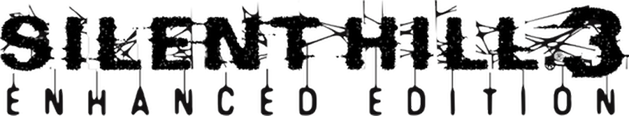

<p align="center">
  <picture>
    <source media="(prefers-color-scheme: dark)" srcset="docs/images/logo-white.png">
    
  </picture>
</p>

# Silent Hill 3 Enhanced Edition for PS Vita

**Version 1.2** — an unofficial fan port of the Windows PC version of Silent Hill 3 to the PS Vita.
You play it with **your own copy** of the PC game: no game files are included here or in the VPK.

**[Download the latest release](../../releases/latest)**: the VPK for the Vita and the data preparer.

> **Status:** this port was made with the help of Claude (Anthropic) and is still in development: expect bugs.
> Please report what you find in the [Issues](../../issues), with your `ux0:data/sh3/sh3log.txt` attached.

## Features

- Runs the full game natively on the Vita: the PC executable is statically recompiled to ARM, no emulation.
- Targets a locked **30 FPS**, the PS2 frame rate.
- Native Vita resolution (960×544), **16:9**, with the 3D scene rendered close to the PS2's 640×448.
- The PS2-era effects kept: flashlight shadows, fog, noise filter, particles.
- **Three control layouts** on a Controls screen in the options: the Vita layout or the PS2 type B layout, with L1 /
  R1 on the rear touch pad or on the screen (see [Controls](#controls)).
- PC-version fixes rebuilt for the Vita: no cutscene bars, 2D menus kept in 4:3, full-screen pause background,
  no black box behind the pause menu.
- Movies played by the port itself, scaled for the Vita.
- Sound effects back at the **PS2 pitch** by default; optional PS2 sounds from the community audio pack and
  widescreen movies (see [Extras](#extras)).
- Puzzles with an on-screen cursor driven by the stick or the D-pad (✕ clicks), map and inventory in their PS2 4:3
  frame with black side bands, and saves that survive a crash while writing.

### Why "Enhanced Edition"

It is not a plain copy of the PC release: the port puts back what the PS2 version had and the PC version lost
(sound pitch, the PS2 audio, the 4:3 framing of 2D screens, the save point seal at full colour), and adds what
playing on a Vita needs (controls, a puzzle cursor, the screen layout, safe saves).

## What's new in 1.2

- **No more shader freezes:** the game used to stop for up to 1.7 seconds the first time it drew something new
  (shooting, some cutscenes, new rooms). The VPK now ships the shaders already compiled, and anything missing is
  compiled in the background while the game keeps running.
- **Controls screen with three layouts** (Options > Button Config): Vita, PS2 rear and PS2 front. The PS2 layouts
  follow the PS2 type B controller: □ runs, ○ flashlight and back, △ map, SELECT items, L / R as L2 / R2, and L1 / R1
  on the left / right half of the rear touch pad or of the screen. Touch both halves for the quick 180° turn.
- **Options pages:** L and R turn the page, so **Extra Options** (blood colour, noise effect, low health indicator)
  can be reached. Running no longer zooms the camera.
- **Crash fixed** when opening Options from the inventory.
- **Silent Hill 2 references:** the four easter eggs of the original game play again.
- New loading and preparation screens and LiveArea artwork.

## What you need

- A PS Vita with custom firmware (HENkaku / Ensō) and about **6 GB** free on `ux0:`.
- `libshacccg.suprx` installed on your own Vita (extract it with
  [ShaRKF00D](https://github.com/Rinnegatamante/ShaRKF00D)); the game tells you if it is missing.
- **Silent Hill 3 for Windows (2003)**, installed on your PC.

  The PC version was only released on DVD (2003) and has never been sold digitally: it is **not on Steam or GOG**
  and no official store sells it today. The way to get it is a used physical copy of the PC DVD (online marketplaces
  and second-hand game shops). The PS2, PS3 (HD Collection) and Xbox 360 versions cannot be used.

  The port only accepts this `sh3.exe`:

  ```text
  SHA-256  A51F956BD5BE21FD704C4D19CF0674A175D002081DA43B1D377BE83226C36E5E
  ```

  Check yours with `certutil -hashfile sh3.exe SHA256` (Windows) or `sha256sum sh3.exe` (Linux/macOS).
  It must be the executable **without SecuROM**; the copy-protected disc executable is not supported, and neither
  are other PC executables. You can also check it with `python sh3exe.py "path\to\sh3.exe"` (included in `sh3prep.zip`).
- [Python 3.10 or newer](https://www.python.org/downloads/) on your PC, to run the data preparer.

## Install

1. Download `sh3vita.vpk` and `sh3prep.zip` from the [Releases](../../releases) page. Extract `sh3prep.zip`.
2. Prepare the game files. Open a terminal in the extracted folder and run, with your own paths:

   ```sh
   python prepare_data.py "C:\Games\Silent Hill 3" "C:\sh3-vita\sh3"
   ```

   The first path is your installed game (the folder with `sh3.exe` and `data/`), the second a new output folder.
   Your game folder is never modified: the preparer copies the game and applies the port's data fixes to the copy.
3. Copy the output **`sh3` folder** to **`ux0:data/`** on the Vita (USB is much faster than FTP). It must look like:

   ```text
   ux0:data/sh3/
     sh3.exe
     data/
     ...
   ```

4. Install `sh3vita.vpk` with VitaShell and start Silent Hill 3 Enhanced Edition from the LiveArea.

Saves and settings stay in `ux0:data/sh3/`. The log of the last launch is `ux0:data/sh3/sh3log.txt`.

### Updating

Install the new VPK over the old one with VitaShell. Keep `ux0:data/sh3/`: you do not need to prepare the files
again unless a release says so.

### Extras

Optional arguments of `prepare_data.py`:

| Option | Effect |
|---|---|
| *(none)* | Sound effects back at the PS2 pitch (the PC release plays them about 9% slower and lower). |
| `--audio-pack PACK` | Uses the PS2 sounds of the community *Silent Hill 3 Audio Enhancement Pack* (zip or folder) instead. |
| `--movies GAME_FOLDER` | Takes the 16:9 movies from a copy of the game where *Widescreen movies for Silent Hill 3* is installed. |
| `--ffmpeg FFMPEG_EXE` | Scales movies wider than 768×432 down for the Vita (smoother playback). |

## Controls

Pick a layout on the Controls screen (Options > Button Config, ◀ / ▶ to change). Your choice is saved at once.

| Vita | Vita layout | PS2 layouts (type B) |
|---|---|---|
| Left stick / D-pad | Move, menus | Move, menus |
| ✕ | Action / attack / confirm | Action / attack / confirm |
| ○ | Back · hold to run | Flashlight · back in menus |
| □ | Flashlight | Run / guard |
| △ | Inventory | Map |
| SELECT | Map | Inventory |
| R | Ready weapon | Ready weapon (R2) |
| L | Camera behind | Camera behind (L2) |
| Rear touch, left / right half | — | L1 / R1 side steps (PS2 rear) |
| Screen, left / right half | — | L1 / R1 side steps (PS2 front) |
| START | Pause menu | Pause menu |

In the PS2 layouts, touching both halves at once does the quick 180° turn. In the options menu, L and R turn the
page in every layout.

## How it works

`sh3.exe` is disassembled and translated to C (static recompilation, `recomp/`), then compiled for the Vita's ARM
CPU. Direct3D 8, DirectInput, DirectSound and the parts of Windows the game uses are reimplemented on top of
[vitaGL](https://github.com/Rinnegatamante/vitaGL) and SDL2 (`port/src/`). The heaviest game functions (shadow
volumes, collision, particles, D3DX maths) are rewritten natively, with NEON where it pays off, and checked against
the recompiled original.

## Building from source

Windows with Git Bash (no WSL needed). You need the same `sh3.exe` as above.

1. Tools: [VitaSDK](https://vitasdk.org/), CMake, GCC/Make (WinLibs), SDL2 for MinGW, Python 3,
   [Ghidra](https://ghidra-sre.org/) 12.2 with JDK 25. By default the scripts look for them in `~/tools`
   (set `SH3_TOOLS`, `VITASDK`, `SH3_SDL2_DIR`, `SH3_GHIDRA` to override); see `tools/env.sh` and `tools/env_vita.sh`.
2. Link your game folder as `game/` in the repository (it must contain `sh3.exe`), then:

   ```sh
   python -m venv .venv && .venv/Scripts/pip install -r requirements.txt
   powershell -File tools/ghidra_export.ps1      # function list -> re/out/functions.json (a few minutes)
   .venv/Scripts/python recomp/x86rec.py         # recompiled C -> port/gen/
   bash tools/build_vitagl.sh                    # patched vitaGL (STORE_DEPTH_STENCIL=1)
   bash port/build_vita.sh                       # -> build/sh3.vpk
   ```

3. Tests: `.venv/Scripts/python -m pytest tests -q`. A PC build for quick checks: `port/Makefile.pc`.

The generated code (`port/gen/`) and everything else derived from the game stays on your machine: never commit it.

## Credits

- Port by [matfsouza](https://github.com/matfsouza), made with the help of Claude (Anthropic).
- The recompiler, runtime and Vita layer start from [sh4vita](https://github.com/vallfrr/sh4vita) by vallfrr.
- [vitaGL](https://github.com/Rinnegatamante/vitaGL), vitaShaRK and SceShaccCgExt by Rinnegatamante;
  SDL2; [pl_mpeg](https://github.com/phoboslab/pl_mpeg) by Dominic Szablewski;
  [TLSF](https://github.com/mattconte/tlsf) by Matthew Conte; math-neon; VitaSDK and the vita-headers contributors.
- Vita outline by Tokyoship (Wikimedia Commons, CC BY 3.0); button icons from Kenney's Input Prompts (CC0).
- The PC fixes follow the behaviour of the community *Silent Hill 3 PC Fix* and ThirteenAG's *Widescreen Fix*,
  reimplemented without their code. The sound pitch table follows the community *SH3PC Sound Fixer*.

## License

The code of this project is **GPLv3** (see [LICENSE](LICENSE)). Third-party components keep their own licenses:
see [THIRD_PARTY_NOTICES.md](THIRD_PARTY_NOTICES.md) and [LICENSES/](LICENSES/).

**SILENT HILL 3 © Konami.** This is an unofficial, non-commercial fan project. It is not affiliated with or endorsed
by Konami or Sony, and it contains no game data: you must own the PC game to use it.
